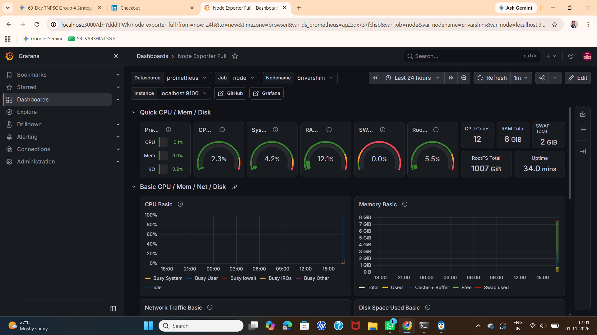
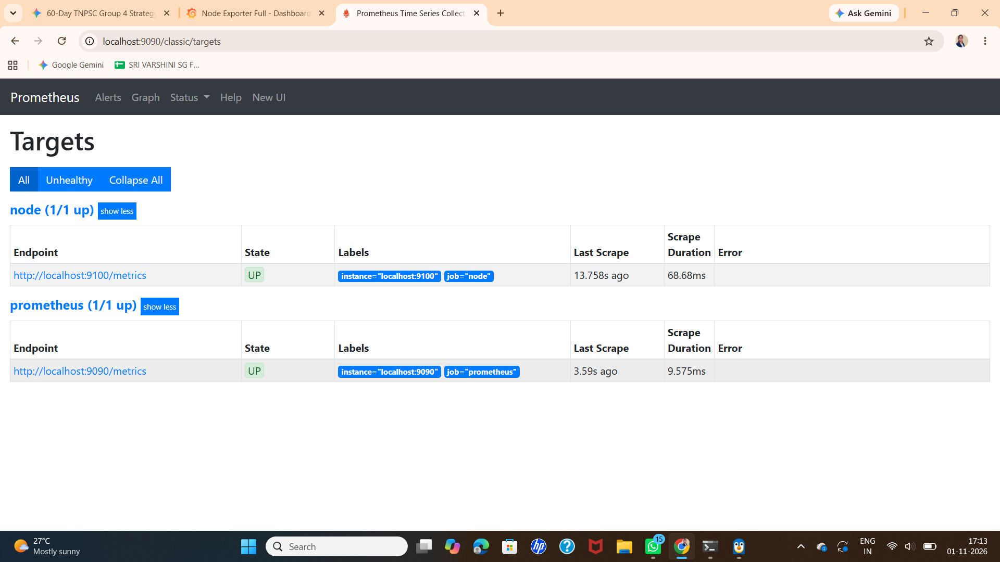

# Cloud Infrastructure Observability & Real-Time Monitoring Stack

A production-style observability and time-series monitoring architecture deployed on Linux using Prometheus, Grafana, and Node Exporter to track system health, resource saturation, and hardware metrics.

## Architecture
- **Target Node:** Linux host running `node_exporter` on port 9100 exposing raw system metrics.
- **Metrics Scraper & TSDB:** `Prometheus` scraping targets every 15s via port 9090.
- **Visualization:** `Grafana` rendering real-time dashboards on port 3000.

## Proof of Execution
### Live System Metrics & Stress Testing

### Prometheus Scrape Targets

## Verification & Stress Testing
Simulated high-load scenarios using the `stress` tool to validate instant anomaly detection:
\`\`\`bash
stress --cpu 4 --timeout 30s &
\`\`\`
CPU utilization spikes were reflected on Grafana within 5 seconds.
